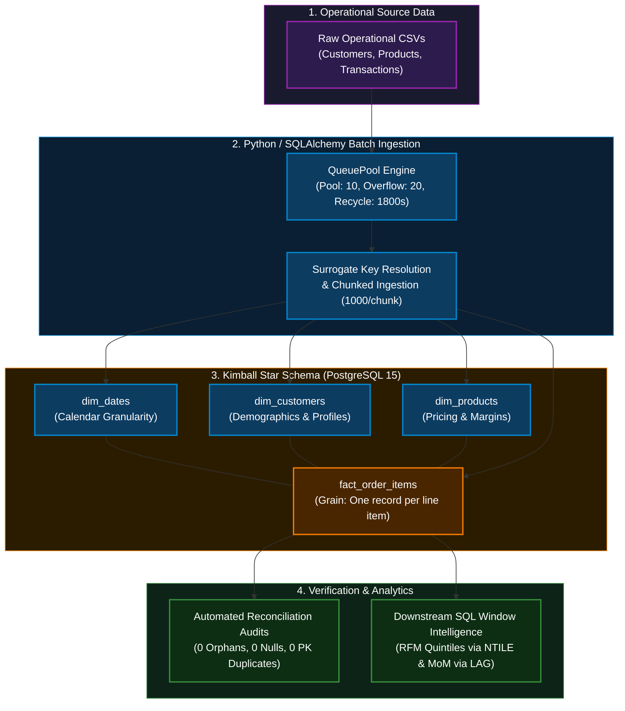
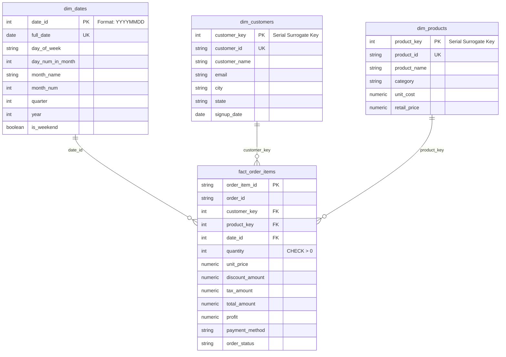

# Enterprise E-Commerce Data Warehouse: Kimball Star Schema, Connection-Pooled ETL & SQL Window Analytics

[](https://www.postgresql.org/)
[](https://www.python.org/)
[](https://www.sqlalchemy.org/)
[](https://www.docker.com/)
[](LICENSE)

An enterprise-grade, relational data warehouse engineered to deliver low-latency analytical aggregations on high-volume e-commerce transactions. Built around the **Kimball Dimensional Modeling methodology**, this warehouse orchestrates automated batch ingestion with resilient SQLAlchemy connection pooling, enforces strict pre-load data quality reconciliations, and models complex business KPIs through optimized PostgreSQL window functions.

---

## 📌 Executive Summary & Architecture

Modern data warehousing requires strict boundaries between operational ingestion and analytical query processing. This system eliminates data integrity risks, connection exhaustion, and query bottlenecks through:

1. **Dimensional Modeling:** Strict Star Schema design segregating business transactions (`fact_order_items`) from analytical entity context (`dim_customers`, `dim_products`, `dim_dates`).
2. **Resilient Connection Pooling:** SQLAlchemy `QueuePool` configuration that manages persistent connections and burst traffic with automatic liveness checks (`pool_pre_ping`).
3. **Automated Quality Audits:** Pre-consumption gatekeeper audits verifying foreign key integrity, non-null guarantees, domain validity, and primary key collision prevention.
4. **Statistical SQL Intelligence:** Advanced window queries calculating dynamic customer segmentation (RFM Quintiles via `NTILE`) and financial velocity (Month-over-Month growth and rolling averages via `LAG`).



---

## 📐 Kimball Star Schema Design

The dimensional model is structured at the grain of **one row per individual transaction line item**.



---

## ⚡ Engineering Implementation Details

### 1. Connection-Pooled Database Engine (`src/db_engine.py`)

To prevent connection leaks and starvation during intensive batch insertions, the engine implements SQLAlchemy's `QueuePool`:

```python
engine = create_engine(
    DATABASE_URL,
    poolclass=QueuePool,
    pool_size=10,             # Persistent active connection pool
    max_overflow=20,          # Handles unexpected ingestion traffic bursts
    pool_timeout=30,          # Fail-safe timeout to prevent hanging threads
    pool_pre_ping=True,       # Active health check: verifies connection liveness
    pool_recycle=1800         # Recycles connections every 30m to prevent stale sockets
)
```

### 2. Idempotent Ingestion & Key Resolution (`src/etl_pipeline.py`)

- **Surrogate Key Resolution:** Replaces raw operational identifiers (`customer_id`, `product_id`) with clean integer surrogate keys (`customer_key`, `product_key`) inside memory buffers before committing records.
- **Chunked Batch Loading:** Utilizes `to_sql(..., method='multi', chunksize=1000)` to execute multi-value batched SQL statements, cutting down network round-trips to the PostgreSQL cluster.

### 3. Automated Data Quality Gatekeeper (`src/data_quality.py`)

Before the warehouse publishes tables for downstream analytics, an automated reconciliation suite evaluates four business rules. If any check fails, execution aborts with exit code `1`.

---

## 📊 Live Telemetry & Verification

The pipeline has been validated end-to-end against a **6,256-transaction operational run** on containerized infrastructure.

### 1. Data Quality Audit Telemetry

```text
=================================================================
>>> STARTING DATA WAREHOUSE INTEGRITY & RECONCILIATION AUDIT
=================================================================
+------------------------------------------------------+---------+------------+----------+
| Audit Check                                          |   Found |   Expected | Status   |
+======================================================+=========+============+==========+
| Check Orphan Records in Fact (Foreign Key Integrity) |       0 |          0 | PASSED   |
+------------------------------------------------------+---------+------------+----------+
| Check Null Values in Business-Critical Fact Columns  |       0 |          0 | PASSED   |
+------------------------------------------------------+---------+------------+----------+
| Check Logical Constraint (Quantity > 0)              |       0 |          0 | PASSED   |
+------------------------------------------------------+---------+------------+----------+
| Duplicate Primary Keys Check (fact_order_items)      |       0 |          0 | PASSED   |
+------------------------------------------------------+---------+------------+----------+

>>> ALL DATA QUALITY AUDITS PASSED WITH ZERO RECONCILIATION ERRORS!
```

### 2. Advanced SQL Window Analytics Output

#### A. RFM Customer Segmentation (`NTILE(5)` Statistical Windowing)

Segments the customer base into 5 statistical quintiles across Recency, Frequency, and Monetary attributes to isolate VIP champions from churn-risk cohorts:

```text
+---------------+--------------------+----------------+------------------+-------------+---------------+
| customer_id   | customer_name      |   total_orders |   monetary_value |   rfm_score | segment       |
+===============+====================+================+==================+=============+===============+
| CUST_0159     | Emily Long         |             18 |          16696.4 |          15 | VIP Champions |
| CUST_0078     | Evelyn Garcia      |             16 |          10686.0 |          15 | VIP Champions |
| CUST_0071     | Jennifer Robertson |             13 |           9308.9 |          15 | VIP Champions |
| CUST_0110     | Renee Jones        |             13 |          15108.1 |          14 | VIP Champions |
| CUST_0130     | Lisa Henderson     |             11 |          13732.0 |          14 | VIP Champions |
+---------------+--------------------+----------------+------------------+-------------+---------------+
```

#### B. Month-over-Month (MoM) Growth & 3-Month Moving Average (`LAG()`)

Measures month-to-month sales velocity and calculates smoothed revenue trends using physical framing windows (`ROWS BETWEEN 2 PRECEDING AND CURRENT ROW`):

```text
+--------+--------------+-------------------------+------------------+------------------+-------------------+
|   year | month_name   |   current_month_revenue |   prev_month_rev |   mom_growth_pct |   rolling_3mo_avg |
+========+==============+=========================+==================+==================+===================+
|   2025 | November     |                  134812 |              nan |              nan |            134812 |
|   2025 | December     |                  150016 |           134812 |            11.28 |            142414 |
|   2026 | January      |                  130785 |           150016 |           -12.82 |            138538 |
|   2026 | February     |                  113154 |           130785 |           -13.48 |            131318 |
|   2026 | March        |                  180094 |           113154 |            59.16 |            141344 |
|   2026 | April        |                  108005 |           180094 |           -40.03 |            133751 |
+--------+--------------+-------------------------+------------------+------------------+-------------------+
```

---

## 🗂️ Repository Structure

```text
ecommerce-data-warehouse-analytics/
├── data/
│   ├── raw_customers.csv
│   ├── raw_orders.csv
│   └── raw_products.csv
├── sql/
│   ├── ddl_schema.sql             # DDL defining Star Schema, tables, and B-tree indexes
│   └── analytics_kpis.sql         # Production analytical window queries
├── src/
│   ├── db_engine.py               # SQLAlchemy QueuePool connection manager
│   ├── data_generator.py          # Controlled mock transaction generator (Faker)
│   ├── etl_pipeline.py            # Surrogate key resolution & chunked loading logic
│   ├── data_quality.py            # Automated reconciliation & integrity test suite
│   └── run_analytics.py           # SQL window execution script
├── scripts/
│   ├── setup_db.ps1               # Container provisioning & schema setup
│   └── run_etl.ps1                # Batch ETL orchestration pipeline
├── docker-compose.yml              # Dedicated PostgreSQL container configuration
├── requirements.txt               # Locked dependencies
└── README.md                      # Architecture documentation & telemetry metrics
```

---

## 🛠️ Tech Stack & Tooling

- **Data Warehouse Engine:** PostgreSQL 15 (Docker containerized)
- **Data Modeling:** Ralph Kimball Star Schema Methodology (Surrogate Keys, Fact Tables, Dimension Tables)
- **Programming & Libraries:** Python 3.10+, SQLAlchemy 2.0 (`QueuePool`), `psycopg2-binary`, Pandas, Faker, Tabulate
- **Infrastructure & Automation:** Docker Compose, PowerShell

---

## 🚦 Getting Started

### Prerequisites

- Docker Desktop installed and running.
- Python 3.10+ installed.

### Execution Instructions

**1. Clone the repository:**

```bash
git clone https://github.com/arsalankazi/ecommerce-data-warehouse-analytics.git
cd ecommerce-data-warehouse-analytics
```

**2. Initialize Python Environment:**

```powershell
python -m venv venv
.\venv\Scripts\Activate.ps1
pip install -r requirements.txt
```

**3. Spin up Infrastructure & Initialize DDL:**

```powershell
.\scripts\setup_db.ps1
```

**4. Execute ETL Batch Pipeline & Quality Audits:**

```powershell
.\scripts\run_etl.ps1
```

**5. Run Window Analytics Queries:**

```powershell
python src\run_analytics.py
```

---

## 👨‍💻 Author & Maintainer

<p align="left">
  
</p>

### **Kazi Arsalan Ajaj Ahmed**
*Data Engineer & Warehouse Architect*

[](https://github.com/arsalankazi)
[](https://linkedin.com/in/arsalankazi)
[](mailto:arsalankazi.dev@gmail.com)

---

### 🎯 Core Engineering Focus

- **Dimensional Modeling:** Kimball Star Schema, Surrogate Key Strategies, Fact Granularity & SCD Types.
- **Pipeline Engineering:** Resilient Connection-Pooled Batch Ingestion, Idempotent Workflows & Automated Reconciliation.
- **Analytical SQL:** Multi-table Joins, CTE Orchestration, and Statistical Window Aggregations (`NTILE`, `LAG`, Rolling Metrics).